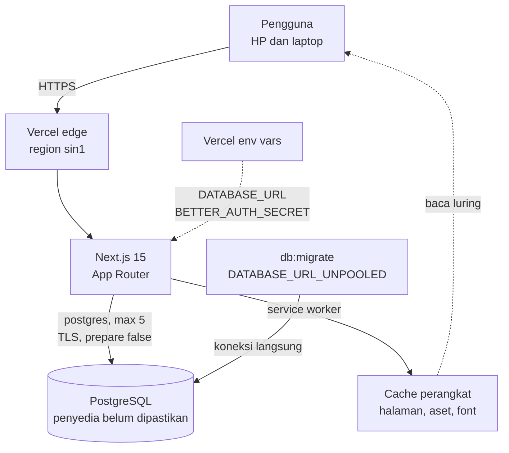

# 24. Infrastruktur dan Operasi

Dokumen ini menjawab satu pertanyaan: apa saja yang berjalan di luar kode aplikasi, siapa yang bertanggung jawab atas tiap bagian, dan bagian mana yang belum punya pemilik.

Isinya bukan rencana baru. Setiap baris punya bukti yang bisa dibuka, dan yang belum diverifikasi ditandai begitu.

Prosedur rilis ada di [`23-Rilis-dan-Penyebaran.md`](23-Rilis-dan-Penyebaran.md). Dokumen ini mengurus hal yang tetap ada di antara dua rilis: hosting, database, rahasia, akses, cadangan, dan pemantauan.

---

## 1. Tiga peran

| Peran | Pertanyaan yang dijawab | Keluaran |
|---|---|---|
| DevOps Engineer | Bagaimana kode sampai ke produksi, dan bagaimana kegagalannya diketahui | Pipeline, health check, pemberitahuan, rollback |
| Cloud Architect | Bentuk sistemnya seperti apa, dan di mana batas skalanya | Topologi, pilihan region, pemisahan lingkungan, batas biaya |
| System Administrator | Siapa yang boleh masuk, dan bagaimana data dipulihkan | Daftar akses, rotasi rahasia, jadwal cadangan, prosedur insiden |

Pada proyek satu orang, ketiganya dipegang orang yang sama. Itu bukan alasan untuk melewatkannya. Yang berubah hanya jumlah orang yang memeriksa, dan itu justru membuat catatan tertulis lebih penting.

---

## 2. Inventaris

Diperiksa 2026-10-19.

| Komponen | Keadaan | Bukti | Status |
|---|---|---|---|
| Hosting aplikasi | Vercel, proyek `wedding-planer` | `.vercel/project.json`, header `Server: Vercel` | Terverifikasi |
| Region | `sin1` (Singapura) | `vercel.json`, `X-Vercel-Id: sin1::...` | Terverifikasi |
| Runtime | Next.js 15.5.26, Node | `package.json`, `next build` | Terverifikasi |
| CDN dan TLS | Vercel edge, HTTPS, HSTS dua tahun | `X-Vercel-Cache`, `Strict-Transport-Security` | Terverifikasi |
| Database | PostgreSQL, penyedia belum dipastikan dari mesin ini | `docs/06` menyebut Neon; `src/db/index.ts` menyiapkan TLS untuk host remote | **Belum diverifikasi** |
| Koneksi database | `max: 5`, `prepare: false`, TLS wajib untuk host bukan loopback | `src/db/index.ts` | Terverifikasi |
| Object storage | Tidak dipakai. `neon.ts` mendefinisikan bucket `test`, tapi tidak ada kode yang membacanya | `neon.ts`, `docs/08` bagian Unggah file | Terverifikasi |
| Domain | `wedding-planer-self.vercel.app`. Tidak ada domain kustom | `vercel.json` tanpa `domains` | Terverifikasi |
| Repositori | Publik, 4 bintang | `api.github.com/repos/begolo12/wedding-planer` | Terverifikasi |
| CI | GitHub Actions, dua job: kualitas dan e2e, keduanya hijau | `.github/workflows/ci.yml`, run `39180299839` | Terverifikasi |
| Pemantauan berkala | Workflow `Jaga`: kesiapan produksi setiap 30 menit, audit dependensi mingguan | `.github/workflows/jaga.yml` | Terverifikasi setelah push |
| Infrastructure as Code | Tidak ada. Tidak ada Terraform, Docker, atau manifes Kubernetes | Daftar akar repo | Terverifikasi |
| Pemantauan | Kesiapan produksi dipanggil tiap 30 menit dan surel terkirim saat gagal. Tidak ada agregasi log dan tidak ada pelacakan galat klien | `.github/workflows/jaga.yml`, `src/app/api/siap/route.ts` | Terverifikasi setelah push |
| Cadangan | Tidak ada bukti dump berjalan | `docs/18` bagian 18 | **Belum diverifikasi** |
| Pemulihan | Belum pernah diuji | `docs/18` bagian 18 | Terverifikasi belum ada |

---

## 3. Topologi

Dua hal yang perlu dibaca dari gambar itu:

**Tidak ada lapisan di antara edge dan database.** Aplikasi berbicara langsung ke Postgres. Tidak ada connection pooler terpisah, tidak ada cache server, tidak ada antrean. Ini sesuai keputusan `docs/06` yang menolak Redis, message queue, dan microservice.

**Migrasi memakai jalur kedua.** `DATABASE_URL_UNPOOLED` ada khusus untuk `db:migrate`, karena migrasi butuh koneksi langsung dan tidak boleh lewat pooler mode transaction. `src/db/index.ts` mematikan prepared statement justru untuk berjaga kalau nanti database dipindah ke belakang PgBouncer.

---

## 4. DevOps: yang sudah dan belum

Irama pemeriksaan dan prosedur insiden ada di [`25-Pemeliharaan-dan-Monitoring.md`](25-Pemeliharaan-dan-Monitoring.md). Bagian ini hanya mencatat apa yang ada dan apa yang belum.

### 4.1 Yang sudah

| Hal | Keadaan |
|---|---|
| Deploy otomatis | Push ke `main` memicu build dan deploy |
| Rollback kode | Promosi deployment sebelumnya dari dashboard Vercel |
| Gerbang pra-rilis | Enam perintah manual, tercatat di `docs/23` bagian 3.1 |
| Pemeriksaan pasca-deploy | Enam pemeriksaan manual, tercatat di `docs/23` bagian 3.4 |
| Tag rilis | `v0.18.0` menunjuk commit yang `package.json`-nya sudah `0.18.0` |

### 4.2 Yang belum

| Belum | Akibat nyata |
|---|---|
| Gerbang sebelum push | Tidak ada yang memaksa gerbang dijalankan di mesin pengembang sebelum push. CI menangkapnya setelah push, bukan sebelum |
| Pemberitahuan tanpa eskalasi | Surel GitHub bisa masuk spam, dan tidak ada jalur kedua |
| Agregasi log | Log hanya bisa dibaca satu per satu di dashboard |
| Pemeriksaan asap otomatis | Enam langkah di `docs/23` dijalankan dengan tangan |

**Temuan penting.** `src/app/api/kesehatan/route.ts` sengaja tidak menyentuh database, dan alasannya benar: kalau endpoint itu membaca database, gangguan database akan terbaca sebagai "sedang luring" di semua perangkat padahal internetnya baik. Konsekuensinya, endpoint itu hanya membuktikan proses Next.js hidup. Klaim lama di `docs/18` yang menyebut 200 dari endpoint ini berarti database terhubung sudah dikoreksi pada 2026-10-19.

Yang dibutuhkan bukan mengubah endpoint itu, melainkan menambah pemeriksaan kesiapan yang terpisah dan benar-benar membaca satu baris dari database, lalu memanggilnya dari luar.

---

## 5. Domain dan TLS

Diukur 2026-10-19.

| Hal | Nilai | Bukti |
|---|---|---|
| Nama host | `wedding-planer-self.vercel.app` | Header `Server: Vercel` |
| Penerbit sertifikat | Google Trust Services, `CN=WR1` | `openssl s_client` |
| Nama di sertifikat | `*.vercel.app` | sama |
| Masa berlaku | 29 Agustus 2026 sampai 27 November 2026 | sama |
| Perpanjangan | Otomatis oleh Vercel | Tidak ada langkah manual |
| HSTS | `max-age=63072000; includeSubDomains` | `HEAD /masuk` |
| Redirect HTTP ke HTTPS | Ditangani Vercel | `Strict-Transport-Security` terkirim |
| Domain kustom | Tidak ada | `vercel.json` tanpa `domains` |

SSL aktif tanpa biaya tambahan karena memakai domain bawaan Vercel. Kalau nanti dipakai domain kustom, tiga hal ini yang berubah dan tidak bisa dikerjakan dari repo: pembelian domain, pengaturan DNS di registrar, dan verifikasi kepemilikan di dashboard Vercel. Sertifikatnya tetap otomatis.

Satu hal yang perlu diingat: masa berlaku sertifikat berakhir 27 November 2026. Perpanjangan otomatis, tapi kalau tanggal itu lewat dan situs membalas galat sertifikat, penyebabnya bukan kode.

---

## 6. Cloud Architect: batas yang sudah ditetapkan

| Keputusan | Nilai | Alasan | Sumber |
|---|---|---|---|
| Satu region | `sin1` | Pengguna di Indonesia, dan satu region menghindari replikasi yang tidak dibutuhkan | `vercel.json` |
| Satu proses | Monolith Next.js | Aplikasi kecil. Microservice hanya menambah jaringan | `docs/06` bagian 3 |
| Satu database | PostgreSQL | Butuh transaksi untuk data pembayaran | `docs/06` bagian 2 |
| Tanpa Redis | Cache memakai `unstable_cache` bawaan Next.js | Belum ada masalah yang menyalakan kebutuhan Redis | `docs/06` bagian 3 |
| Tanpa message queue | Tidak ada proses latar di Fase 1 | Sama | `docs/06` bagian 3 |
| Tanpa object storage | Unggah bukti transfer ditunda | Menambah vendor baru tanpa nilai di Fase 1 | `docs/08` bagian Unggah file |
| Batas koneksi | 5 | Satu instance, dan Postgres serverless membatasi koneksi | `src/db/index.ts` |

### 6.1 Yang belum ditetapkan

| Belum | Kenapa penting |
|---|---|
| Batas skala | Belum ada angka pengguna, permintaan per detik, atau ukuran database yang diuji |
| Pemisahan lingkungan | Produksi, preview, dan pengembangan belum dipastikan memakai database berbeda |
| RPO dan RTO | Belum ada target berapa data boleh hilang dan berapa lama pemulihan boleh makan waktu |
| Biaya | Belum diukur. Tidak ada angka di dokumen ini karena tidak ada sumbernya |
| Region database | Belum dipastikan sama dengan `sin1`. Kalau berbeda, setiap query menyeberang region |

Pemisahan lingkungan adalah yang paling mendesak dari daftar itu. Alasannya di bagian 7.

---

## 7. System Administrator: akses, rahasia, cadangan

### 7.1 Rahasia

| Rahasia | Tempat | Terlacak Git? |
|---|---|---|
| `DATABASE_URL` | Variabel lingkungan Vercel, `.env` lokal | Tidak. `.gitignore` menutup `.env*` |
| `DATABASE_URL_UNPOOLED` | Variabel lingkungan, dipakai `db:migrate` | Tidak |
| `BETTER_AUTH_SECRET` | Variabel lingkungan | Tidak |
| `GOOGLE_CLIENT_SECRET` | Variabel lingkungan | Tidak |

Pemeriksaan 2026-10-19: nol berkas terlacak memuat pola kunci AWS, kunci Stripe, kunci privat, atau URL Postgres berkredensial.

Yang belum ada: rotasi rahasia terjadwal, pemindaian rahasia otomatis di CI, dan catatan siapa saja yang bisa membaca variabel lingkungan Vercel.

### 7.2 Akses

| Pertanyaan | Keadaan |
|---|---|
| Siapa yang bisa menekan deploy ke produksi | Belum dicatat |
| Siapa yang bisa membaca variabel lingkungan | Belum dicatat |
| Siapa yang bisa menghapus database | Belum dicatat |
| Apakah 2FA wajib di Vercel, GitHub, dan penyedia database | Belum dicatat |

Repositori bersifat publik. Itu keputusan yang sah, tapi konsekuensinya perlu ditulis: kode bisa dibaca siapa pun, dan siapa pun bisa membuka pull request yang memicu build preview.

### 7.3 Cadangan dan pemulihan

| Hal | Keadaan |
|---|---|
| Dump harian | Tidak ada bukti berjalan |
| Retensi | Belum ditetapkan |
| Uji restore | Belum pernah |
| Tempat penyimpanan dump | Belum ada |
| Prosedur pemulihan tertulis | Belum ada |

Rollback kode tidak mengembalikan data. Satu-satunya jalan adalah cadangan. Karena itu baris pertama daftar prioritas di bagian 8 adalah cadangan, bukan fitur.

---

## 8. Risiko yang perlu ditutup

| Risiko | Bukti atau alasan | Dampak |
|---|---|---|
| Preview deployment memakai database produksi | Vercel membuat deployment preview untuk setiap push cabang. Isi `DATABASE_URL` untuk lingkungan preview belum diverifikasi | Siapa pun yang membuka URL preview bisa menulis ke data produksi lewat akun uji |
| Health check memberi rasa aman palsu | Endpoint tidak membaca database | Database mati tidak terdeteksi |
| Tidak ada cadangan | `docs/18` bagian 18 | Kehilangan data pembayaran tidak bisa dipulihkan |
| Repositori publik | `api.github.com` menjawab `private: false` | Permukaan serangan bisa dipelajari siapa pun. Bukan cacat, tapi harus disertai disiplin rahasia |
| Tidak ada batas skala | Belum diukur | Beban tak terduga tidak punya angka pembanding |
| Region database belum dipastikan | Belum diverifikasi | Kalau beda region, latensi setiap query naik tanpa terlihat di kode |

---

## 9. Urutan kerja

| # | Langkah | Peran | Alasan urutan |
|---|---|---|---|
| 1 | Konfirmasi database preview, produksi, dan pengembangan berbeda | SysAdmin | Tanpa ini, uji dan preview bisa merusak data produksi |
| 2 | Jadwal dump harian dan satu uji restore | SysAdmin | Satu-satunya perlindungan terhadap kehilangan data |
| 3 | Pemeriksaan kesiapan yang membaca database, dipanggil dari luar | DevOps | Mengganti sinyal palsu dengan sinyal yang benar |
| 4 | Pemberitahuan saat kesiapan gagal | DevOps | Tanpa ini, kegagalan hanya ketahuan dari keluhan |
| 5 | Pasang perlindungan cabang: wajib CI hijau sebelum merge | DevOps | Workflow sudah hijau, tapi belum diwajibkan |
| 6 | Catatan akses dan rotasi rahasia | SysAdmin | Menjawab siapa bisa melakukan apa |
| 7 | Ukur biaya dan batas skala | Cloud Architect | Baru bisa diukur setelah ada angka pemakaian |

Nomor 1 dan 2 tidak butuh kode. Keduanya bisa dikerjakan hari ini.

---

## 10. Container: keputusan dan alasannya

Docker tidak dipakai. Ini bukan kelalaian, dan lima pertanyaan di `docs/06` bagian 4 sudah dijawab:

| Pertanyaan | Jawaban |
|---|---|
| Apakah ini cuma benar kalau bertahan sampai sepuluh ribu pengguna? | Tidak. Container tidak menambah kapasitas apa pun di sini |
| Apakah Phase 1 benar-benar butuh? | Tidak. Vercel sudah membangun dan menjalankan aplikasi Next.js |
| Berapa biaya pemeliharaannya? | Satu `Dockerfile` berarti satu jalur build kedua yang harus ikut diperbarui setiap kali dependensi berubah |
| Kalau nanti dibuang, berapa biaya pencabutannya? | Sedang. Berkasnya kecil, tapi orang akan memakainya untuk men-deploy lalu menemukan jalur itu tidak terpelihara |
| Bisakah masalahnya diselesaikan tanpa teknologi baru? | Ya. `npm run build` di Vercel sudah reproducible dari lockfile |

Karena pertanyaan kelima dijawab "bisa", jawabannya selesai dan `Dockerfile` tidak ditambahkan. Kalau nanti pindah platform atau butuh jalan keluar dari Vercel, keputusan itu dibuka lagi dan lima pertanyaan yang sama dijawab ulang.

Yang menggantikan container adalah reproducibility lewat tiga hal: `package-lock.json` yang dikunci, versi Node yang ditetapkan CI, dan `npm ci` di pipeline.

---

## 11. Yang sengaja tidak dibangun

| Tidak dibangun | Alasan |
|---|---|
| Docker dan container | Dijawab di bagian 10 |
| Kubernetes | Satu container di platform terkelola sudah cukup. `docs/06` menolaknya |
| Infrastructure as Code | Satu platform, satu proyek, satu database. Menulis Terraform untuk tiga resource menambah lapisan yang harus dijaga |
| Multi-region | Pengguna di satu negara, dan replikasi menambah biaya serta konsistensi yang harus diurus |
| Alat observability berbayar | `docs/06` menolak Sentry. Mulai dari log platform dan satu pemeriksaan kesiapan |
| Object storage | Tidak ada berkas yang diunggah di Fase 1 |

Kalau salah satu dari daftar ini dibutuhkan nanti, lima pertanyaan di `docs/06` bagian 4 yang menentukan, bukan dokumen ini.
