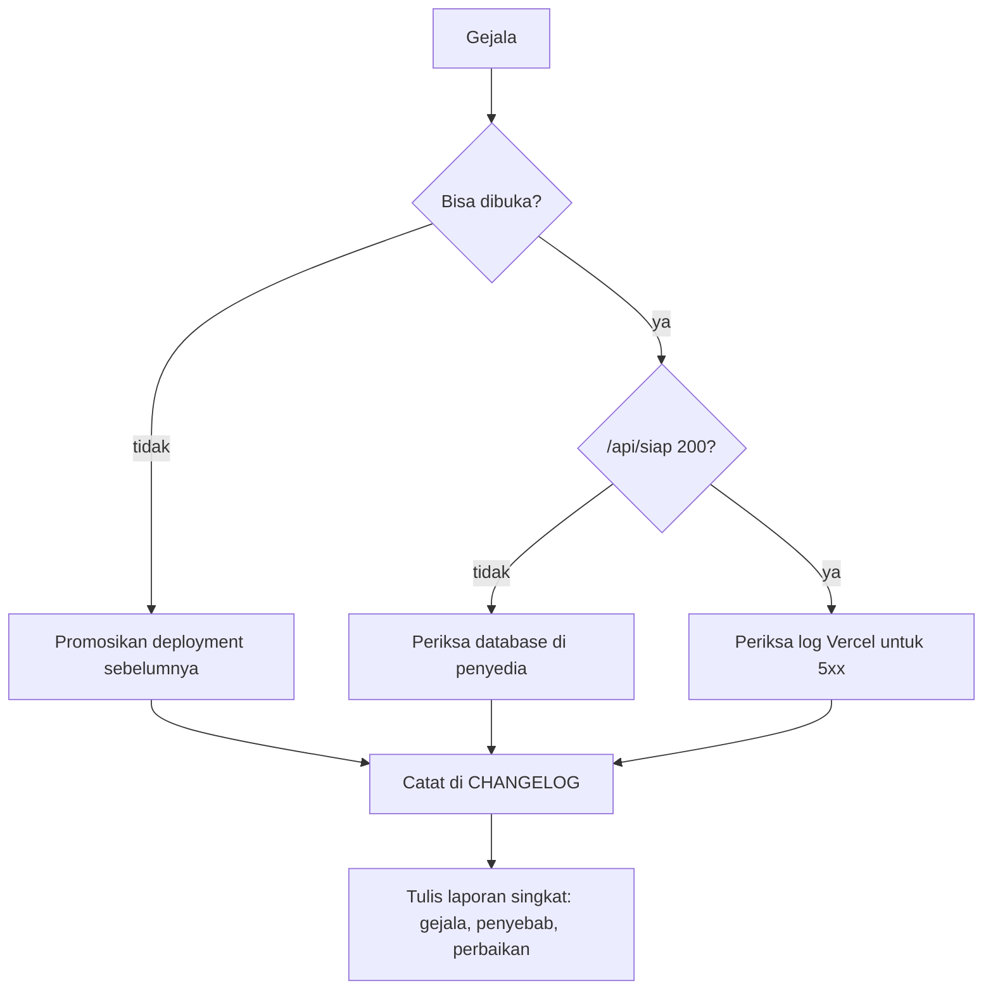

# 25. Pemeliharaan dan Pemantauan

Dokumen ini menjawab satu pertanyaan: setelah aplikasi tayang, apa yang diperiksa, seberapa sering, dan apa yang dilakukan kalau ada yang rusak.

Rilis dan rollback ada di [`23-Rilis-dan-Penyebaran.md`](23-Rilis-dan-Penyebaran.md). Topologi dan akses ada di [`24-Infrastruktur-dan-Operasi.md`](24-Infrastruktur-dan-Operasi.md). Dokumen ini mengurus hal yang berulang di antara rilis.

---

## 1. Dua titik pemeriksaan, dan kenapa dua

| Endpoint | Membaca database | Dipanggil oleh | Gunanya |
|---|---|---|---|
| `/api/kesehatan` | Tidak | Penjaga koneksi di perangkat | Menjawab "apakah internetnya ada", bukan "apakah servernya sehat" |
| `/api/siap` | Ya, `select 1` | Pemantau dari luar | Menjawab "apakah aplikasi bisa melayani", termasuk database |

Pemisahan ini bukan kerapian. Kalau `/api/kesehatan` ikut membaca database, satu gangguan database akan membuat semua perangkat mengira sinyalnya hilang, lalu menyembunyikan tombol tambah dan menampilkan pita luring padahal internetnya baik. Karena itu endpoint itu tetap tidak menyentuh database.

Sebaliknya, pemantau dari luar butuh endpoint yang benar-benar membuktikan database terbaca. Itu `/api/siap`.

Bukti pemisahan itu bekerja, diukur 2026-10-19 dengan `DATABASE_URL` diarahkan ke port yang tidak ada:

| Endpoint | Jawaban | Arti |
|---|---|---|
| `/api/siap` | `503 {"siap":false}` | Database mati terdeteksi |
| `/api/kesehatan` | `200 {"ok":true}` | Proses hidup, dan perangkat tidak salah menyimpulkan luring |

Kalau kedua endpoint menjawab sama, salah satunya tidak berguna.

---

## 2. Yang dipantau sekarang

| Sinyal | Alat | Frekuensi | Pemberitahuan |
|---|---|---|---|
| Kesiapan produksi | `.github/workflows/jaga.yml`, memanggil `/api/siap` | Setiap 30 menit | Surel GitHub saat workflow gagal |
| Kerentanan dependensi | job `dependensi` di workflow yang sama | Mingguan, Senin 03.00 UTC | Surel GitHub saat workflow gagal |
| Gerbang kode | `.github/workflows/ci.yml` | Setiap push dan pull request | Surel GitHub saat merah |
| Log galat server | Log platform Vercel | Selama ada yang membuka dashboard | Tidak ada |
| Sertifikat TLS | Perpanjangan otomatis Vercel | Otomatis | Tidak ada |

Bukti kedua job pemantauan berjalan: run `39181196427` pada 2026-10-19, `Kesiapan produksi` dan `Audit dependensi mingguan` sama-sama hijau.

### 2.1 Kenapa GitHub Actions, bukan layanan uptime

`docs/06` menolak menambah vendor selama masalahnya bisa diselesaikan dengan yang sudah ada. Repositori sudah di GitHub, dan GitHub mengirim surel ke pemilik repositori saat workflow terjadwal gagal. Itu pemberitahuan yang benar-benar sampai, tanpa vendor baru dan tanpa biaya.

Keterbatasan yang harus ditulis jujur:

- Cron GitHub tidak dijamin tepat waktu. Pada jam sibuk, jadwal bisa mundur belasan menit.
- Pemeriksaan hanya dari satu lokasi, yaitu runner GitHub.
- Surel bisa masuk folder spam, dan tidak ada eskalasi kalau tidak dibaca.
- Workflow terjadwal dimatikan otomatis setelah 60 hari tanpa aktivitas repositori.

Untuk situs yang dipakai satu pasangan, jeda selama itu masih bisa diterima. Kalau nanti butuh deteksi per menit, itu keputusan terpisah dengan alat berbayar, dan lima pertanyaan `docs/06` harus dijawab lebih dulu.

---

## 3. Irama pemeliharaan

### 3.1 Setiap rilis

| Langkah | Rujukan |
|---|---|
| Enam gerbang pra-rilis | [`23`](23-Rilis-dan-Penyebaran.md) bagian 3.1 |
| Enam pemeriksaan pasca-deploy | [`23`](23-Rilis-dan-Penyebaran.md) bagian 3.4 |
| Entri `CHANGELOG.md` | `AGENTS.md` bagian 7 |

### 3.2 Mingguan

| Yang dikerjakan | Kenapa |
|---|---|
| Baca hasil job `dependensi` | Kerentanan baru muncul tanpa kode berubah |
| Baca log Vercel untuk galat 5xx | Satu-satunya cara melihat galat yang tidak sampai ke pemantau |
| Periksa antrean luring yang dilaporkan pengguna | Kalau ada laporan, itu tanda pertama ada data yang tidak terkirim |

### 3.3 Bulanan

| Yang dikerjakan | Kenapa |
|---|---|
| Tinjau `docs/18` bagian 18 | Daftar celah berubah, dan yang sudah selesai harus dicoret |
| Tinjau temuan `docs/19` dan `docs/20` | Pastikan tidak ada yang kembali |
| Periksa masa berlaku sertifikat | Berakhir 27 November 2026, diperpanjang otomatis, tapi tetap diperiksa |
| Putuskan naik versi mayor | `next` 16 sudah tersedia, dan keputusannya belum diambil |

### 3.4 Per kuartal

| Yang dikerjakan | Kenapa |
|---|---|
| Uji restore dari cadangan | Belum pernah dilakukan. Tanpa uji, cadangan hanya asumsi |
| Ukur ulang performa | Belum ada angka Lighthouse dan Core Web Vitals |
| Retro | Lihat bagian 6 |

---

## 4. Prosedur insiden

### 4.1 Gejala dan langkah pertama

| Gejala | Kemungkinan penyebab | Langkah pertama |
|---|---|---|
| Surel "Kesiapan produksi" gagal | Database mati, atau kredensial berubah | Buka `https://wedding-planer-self.vercel.app/api/siap`, lalu periksa status database di penyedia |
| Situs membalas 500 di semua halaman | Build rusak atau variabel lingkungan hilang | Promosikan deployment sebelumnya, lalu periksa log build |
| Situs membalas 504 | Fungsi serverless kehabisan waktu | Periksa apakah database lambat, lalu lihat query terakhir di log |
| Pengguna melaporkan data hilang | Kemungkinan besar antrean luring tidak terkirim | Minta email akun, periksa antrean di perangkat, jangan menyuruh menghapus data situs |
| Sertifikat kedaluwarsa | Perpanjangan otomatis gagal | Periksa domain di dashboard Vercel |

### 4.2 Urutan yang selalu sama



Aturan yang tidak boleh dilanggar saat insiden:

| Aturan | Alasan |
|---|---|
| Jangan menjalankan migrasi untuk memperbaiki insiden | Migrasi tidak punya langkah mundur, dan menambah perubahan di tengah gangguan memperbesar kemungkinan salah |
| Jangan menghapus data pengguna untuk "membersihkan" | Data pembayaran tidak bisa dipulihkan tanpa cadangan, dan cadangan belum ada |
| Catat waktu setiap langkah | Tanpa itu, penyebabnya tidak bisa ditelusuri |
| Perbaiki penyebab, bukan gejalanya | Menyembunyikan galat 5xx tidak membuat database hidup |

---

## 5. Iterasi

### 5.1 Sumber masukan

| Sumber | Bentuk | Tempat mencatat |
|---|---|---|
| Laporan pengguna | Kalimat, tangkapan layar | `docs/19` kalau terbukti cacat, atau issue di repositori |
| Temuan audit | Bukti dan dampak | `docs/19`, `docs/20` |
| Celah terbuka | Daftar berprioritas | `docs/18` bagian 18 |
| Hasil pemantauan | Workflow merah, log 5xx | Langsung jadi pekerjaan, bukan catatan |
| Retro | Pelajaran proses | `CHANGELOG` dan dokumen yang relevan |

### 5.2 Urutan prioritas

Tidak berubah dari `docs/18` bagian 2: P0 dulu, lalu P1, lalu P2. Yang ditambahkan di sini hanya satu aturan: temuan dari pemantauan otomatis masuk P0 kalau menyentuh data, dan P1 kalau hanya menyentuh tampilan.

Alasannya, satu-satunya kerusakan yang tidak bisa diperbaiki di aplikasi ini adalah kehilangan data pembayaran.

### 5.3 Siklus satu perubahan

```text
Laporan atau temuan
  -> tulis bukti dan langkah reproduksi
  -> tentukan tingkat
  -> tulis test yang gagal
  -> perbaiki
  -> gerbang lokal
  -> push, CI hijau
  -> deploy
  -> periksa pasca-deploy
  -> catat di CHANGELOG
```

Skill yang dipakai untuk siklus ini ada di `.agents/skills`: `diagnosing-bugs` untuk menelusuri, `tdd` untuk test lebih dulu, `code-review` sebelum merge, dan `retro` setelahnya.

---

## 6. Retro

Retro dilakukan per kuartal, dan setelah setiap insiden yang membuat situs tidak bisa dipakai.

| Pertanyaan | Keluaran |
|---|---|
| Apa yang terjadi, dalam urutan waktu | Satu paragraf, tanpa menyalahkan orang |
| Apa yang mendeteksinya | Kalau jawabannya "tidak ada", itu temuan tersendiri |
| Berapa lama sampai terdeteksi | Angka, bukan perasaan |
| Apa yang menghentikannya | Perbaikan, rollback, atau menunggu |
| Apa yang diubah supaya tidak terulang | Satu perubahan yang bisa diperiksa, bukan janji |

Kalau jawaban pertanyaan keempat adalah "menunggu", artinya tidak ada langkah yang bisa dijalankan, dan itu masuk daftar celah.

---

## 7. Cadangan dan pemulihan

### 7.1 Alat

`scripts/cadangan.mjs`, tanpa dependensi baru. Memakai `pg_dump` dan `pg_restore` dari klien PostgreSQL.

| Perintah | Isi |
|---|---|
| `npm run cadangan` | Menulis satu berkas ke `cadangan/`, format custom, menyimpan 7 berkas terakhir |
| `node scripts/cadangan.mjs --daftar` | Menampilkan berkas yang ada beserta ukurannya |
| `node scripts/cadangan.mjs --pulihkan <berkas> <database>` | Memulihkan ke database lain |

Alasan memakai skrip sendiri, bukan fitur penyedia: penyedia database belum dipastikan, dan `docs/18` mencatat dump harian belum terbukti berjalan. Skrip ini jalan di mana saja `pg_dump` ada, jadi tidak mengunci keputusan ke satu penyedia.

Pengaman yang dipasang di skrip: pemulihan menolak kalau database tujuan sama dengan database sumber. Tanpa itu, satu salah ketik bisa menimpa data yang sedang dipakai dengan cadangan lama.

### 7.2 Bukti uji restore

Diuji 2026-10-19 terhadap database pengembangan:

| Langkah | Hasil |
|---|---|
| `npm run cadangan` | `rapi-nikah-20261019-0740.dump`, 55.851 byte |
| Buat database tujuan kosong | `wedding_pulih` |
| `--pulihkan` ke database tujuan | Selesai tanpa galat |
| Bandingkan isi | Asal dan hasil pulih sama: 16 tabel, 8 users, 9 plans, 21 payments |
| Bersihkan | Database uji dan berkas dump dihapus |

Artinya skripnya bekerja, dan pemulihan penuh mungkin dilakukan. Yang belum: jadwal otomatis dan tempat penyimpanan di luar mesin ini.

### 7.3 Yang masih kurang

| Belum | Akibat |
|---|---|
| Jadwal harian | Cadangan hanya ada kalau seseorang menjalankannya |
| Penyimpanan di luar mesin | Bencana pada mesin ini ikut menghapus cadangan |
| Uji restore terjadwal | Uji ini manual, dan bisa terlupakan |

---

## 8. Performa

`scripts/kinerja.mjs`, tanpa dependensi baru. Mengukur dua endpoint publik yang aman dipanggil berulang: `/api/kesehatan` dan `/api/siap`. Endpoint yang menulis tidak diukur karena memanggilnya berulang akan mengubah data.

Hasil 2026-10-19 terhadap produksi, `n=120`, konkurensi 12, dua kali berturut-turut:

| Endpoint | p50 | p95 | maks | Galat |
|---|---|---|---|---|
| `/api/kesehatan` | 50ms dan 48ms | 135ms dan 125ms | 290ms dan 314ms | 0 |
| `/api/siap` | 49ms dan 49ms | 99ms dan 79ms | 138ms dan 204ms | 0 |

Satu pengukuran pertama dengan `n=60` menunjukkan p95 942ms pada `/api/kesehatan`. Pengukuran ulang dengan jumlah lebih besar menunjukkan 135ms. Selisih itu konsisten dengan cold start fungsi serverless, bukan dengan beban. Karena itu angka yang dipakai adalah hasil pengukuran berulang, dan pengukuran pertama tidak dipakai sebagai patokan.

Persentil dipakai, bukan rata-rata, karena rata-rata menyembunyikan ekor yang justru terasa oleh pengguna.

---

## 9. Yang belum dipantau

| Belum | Akibat | Yang dibutuhkan |
|---|---|---|
| Jadwal cadangan harian | Kerusakan data tidak bisa dipulihkan tanpa cadangan terbaru | Penjadwalan dan penyimpanan di luar mesin |
| Agregasi log | Galat hanya terbaca satu per satu di dashboard | Alat agregasi, atau ekspor log berkala |
| Pelacakan galat di sisi klien | Galat di browser pengguna tidak pernah terlihat | Alat pelacakan, dan itu vendor baru |
| Angka Core Web Vitals | Waktu jawab API sudah diukur, waktu render halaman belum | Lighthouse |
| Deteksi per menit | Jeda deteksi sampai 30 menit | Alat uptime berbayar |
| Perlindungan cabang | CI hijau tapi tidak diwajibkan sebelum merge | Pengaturan di GitHub, bukan kode |
| Pemisahan database preview | Preview bisa menulis ke data produksi | Konfirmasi variabel lingkungan per lingkungan |

Baris-baris ini sengaja tidak dikerjakan sekarang, dan alasannya sudah tertulis di `docs/24` bagian 8. Yang berubah setelah dokumen ini ada: kesiapan produksi, kerentanan dependensi, alat cadangan, uji restore, dan pengukuran waktu jawab API tidak lagi ada di daftar itu.

---

## 10. Tim Support

### 10.1 Keadaan sekarang

| Hal | Keadaan |
|---|---|
| Kanal yang ditautkan dari aplikasi | Halaman `/kebijakan` menunjuk `github.com/begolo12/wedding-planer/issues` |
| Sifat kanal | Publik. Siapa pun bisa membaca, dan repositorinya sendiri juga publik |
| Tombol lapor masalah di dalam aplikasi | Tidak ada |
| Alamat surel resmi | Belum ada |
| Target waktu respons | Belum ditetapkan |
| Pemilik triage | Belum ada orangnya |

**Masalah yang nyata.** Halaman `/kebijakan` menawarkan kanal itu untuk pertanyaan soal data pribadi. Halaman Issues publik bukan tempat untuk itu: pertanyaan "kenapa data tamu saya hilang" biasanya menyertakan nama, email, atau cuplikan daftar tamu, dan semuanya akan terbaca siapa pun. Kanal yang salah untuk satu jenis pertanyaan lebih buruk daripada tidak ada kanal, karena orang akan memakainya.

Peringatan itu sudah ditambahkan ke paragraf kontak di `/kebijakan` pada 2026-10-19: jangan menulis nama tamu, nomor telepon, jumlah uang, atau alamat surel di kanal publik. Itu mengurangi risiko, tapi tidak menghilangkannya, karena kanal privat belum ada.

Karena itu "kanal dukungan yang tidak publik" masuk P1 di [`26`](26-Rencana-Siklus-Berikutnya.md) nomor 5.

### 10.2 Triage

Support tidak memperbaiki. Support memilah, mengumpulkan bukti, dan menyerahkan ke yang memperbaiki.

| Jenis laporan | Pemilik | Langkah pertama | Eskalasi ke |
|---|---|---|---|
| Tidak bisa masuk | Support | Tanya apakah akun dibuat dengan kata sandi atau Google. Kalau kata sandi, catat bahwa pemulihan belum ada | Backend |
| Data tidak muncul padahal sudah diisi | Support | Tanya apakah ada pita "Menampilkan data dari perangkat" atau "Tidak ada koneksi". Kalau ada, periksa antrean luring | Frontend |
| Angka uang salah | Support | Minta tiga angka: total rencana, total terbayar, dan satu pembayaran yang dianggap hilang. Jangan minta seluruh data | Backend |
| Halaman rusak atau tidak bisa dibuka | Support | Catat rute, waktu, dan perangkat. Cek `/api/siap` saat itu juga | DevOps |
| Laporan keamanan atau kebocoran | Support | Jangan dibalas di kanal publik. Pindahkan ke kanal privat, catat waktunya | DevOps |
| Permintaan fitur | Support | Catat, jangan janjikan tanggal | Pemilik produk |

Aturan yang dipegang saat triage:

| Aturan | Alasan |
|---|---|
| Jangan pernah meminta kata sandi | Tidak ada alasan sah, dan permintaan itu melatih orang menyerahkan rahasianya |
| Jangan meminta seluruh isi data rencana | Tiga angka cukup untuk memulai. Data tamu dan pembayaran adalah data pribadi |
| Jangan menyuruh menghapus data situs atau menginstal ulang | Antrean luring bisa hilang, dan itu data yang tidak bisa dipulihkan tanpa cadangan |
| Jangan menjanjikan waktu perbaikan | Belum ada target yang ditetapkan, dan janji yang tidak bisa dipenuhi lebih buruk daripada tidak menjanjikan |
| Catat waktu laporan masuk dan waktu diteruskan | Tanpa itu, lama deteksi tidak bisa diukur |

### 10.3 Isi laporan yang diteruskan ke developer

| Kolom | Isi |
|---|---|
| Waktu | Kapan laporan masuk, dalam WIB |
| Perangkat dan peramban | Dari laporan pengguna, bukan ditebak |
| Rute | Alamat halaman yang bermasalah |
| Langkah | Apa yang dilakukan tepat sebelum masalah muncul |
| Hasil yang diharapkan dan yang terjadi | Satu kalimat masing-masing |
| Bukti | Tangkapan layar, atau keluaran `curl` kalau menyangkut API |
| Tingkat awal | Berat, sedang, ringan, menurut `docs/22` bagian 4.2 |
| Yang sudah dicoba | Supaya developer tidak mengulang langkah yang sama |

Laporan yang diteruskan tanpa kolom ini akan dikembalikan. Bukan karena formalitas, tapi karena laporan tanpa langkah reproduksi berubah menjadi tebakan, dan `docs/19` sudah menunjukkan bahwa setiap temuan di sana punya bukti yang bisa dibuka.

### 10.4 Yang belum diputuskan

| Pertanyaan | Kenapa menunggu pemilik produk |
|---|---|
| Kanal privat mana yang dipakai | Surel resmi, formulir, atau WhatsApp bisnis punya biaya dan kewajiban berbeda |
| Berapa lama waktu respons yang dijanjikan | Janji itu mengikat, dan belum ada orang yang menjaga kanal setiap hari |
| Siapa yang memegang triage | Pada proyek satu orang, itu orang yang sama dengan developer, dan kelelahan peran adalah risiko nyata |

Selama tiga pertanyaan itu belum dijawab, bagian ini adalah prosedur yang siap dipakai, bukan janji layanan.
