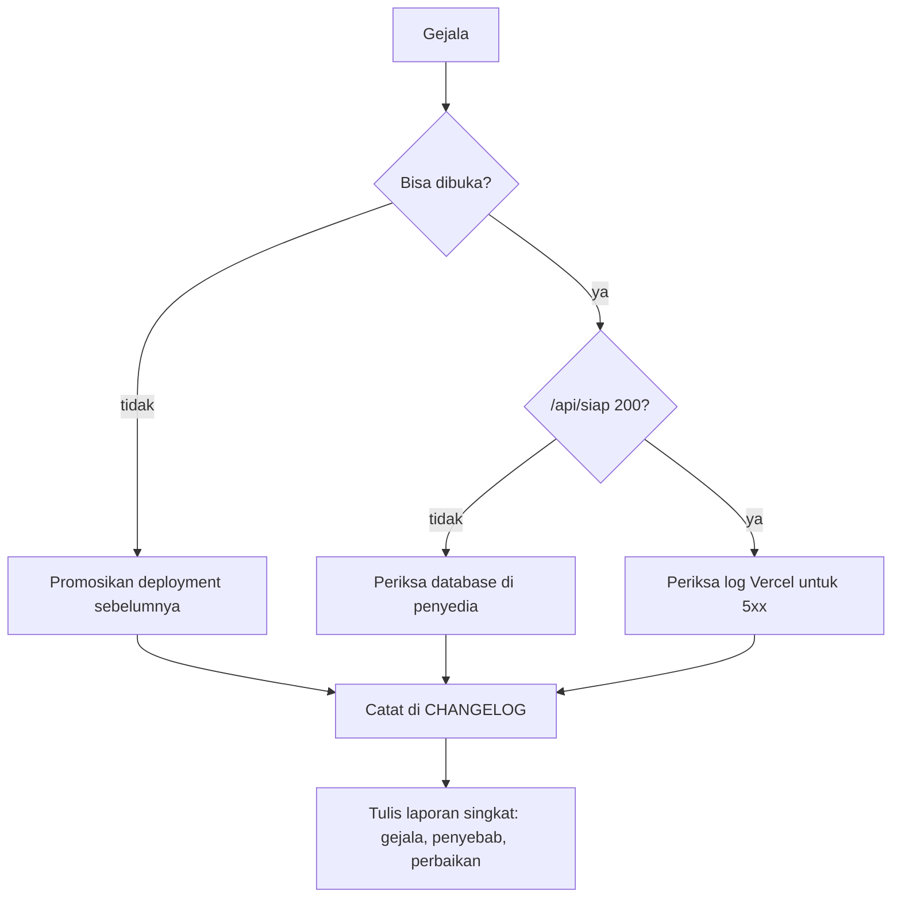

# 25. Pemeliharaan dan Pemantauan

Dokumen ini menjawab satu pertanyaan: setelah aplikasi tayang, apa yang diperiksa, seberapa sering, dan apa yang dilakukan kalau ada yang rusak.

Rilis dan rollback ada di [`23-Rilis-dan-Penyebaran.md`](23-Rilis-dan-Penyebaran.md). Topologi dan akses ada di [`24-Infrastruktur-dan-Operasi.md`](24-Infrastruktur-dan-Operasi.md). Dokumen ini mengurus hal yang berulang di antara rilis.

---

## 1. Dua titik pemeriksaan, dan kenapa dua

| Endpoint | Membaca database | Dipanggil oleh | Gunanya |
|---|---|---|---|
| `/api/kesehatan` | Tidak | Penjaga koneksi di perangkat | Menjawab "apakah internetnya ada", bukan "apakah servernya sehat" |
| `/api/siap` | Ya, `select 1` | Pemantau dari luar | Menjawab "apakah aplikasi bisa melayani", termasuk database |

Pemisahan ini bukan kerapian. Kalau `/api/kesehatan` ikut membaca database, satu gangguan database akan membuat semua perangkat mengira sinyalnya hilang, lalu menyembunyikan tombol tambah dan menampilkan pita luring padahal internetnya baik. Karena itu endpoint itu tetap tidak menyentuh database.

Sebaliknya, pemantau dari luar butuh endpoint yang benar-benar membuktikan database terbaca. Itu `/api/siap`.

Bukti pemisahan itu bekerja, diukur 2026-10-19 dengan `DATABASE_URL` diarahkan ke port yang tidak ada:

| Endpoint | Jawaban | Arti |
|---|---|---|
| `/api/siap` | `503 {"siap":false}` | Database mati terdeteksi |
| `/api/kesehatan` | `200 {"ok":true}` | Proses hidup, dan perangkat tidak salah menyimpulkan luring |

Kalau kedua endpoint menjawab sama, salah satunya tidak berguna.

---

## 2. Yang dipantau sekarang

| Sinyal | Alat | Frekuensi | Pemberitahuan |
|---|---|---|---|
| Kesiapan produksi | `.github/workflows/jaga.yml`, memanggil `/api/siap` | Setiap 30 menit | Surel GitHub saat workflow gagal |
| Kerentanan dependensi | job `dependensi` di workflow yang sama | Mingguan, Senin 03.00 UTC | Surel GitHub saat workflow gagal |
| Gerbang kode | `.github/workflows/ci.yml` | Setiap push dan pull request | Surel GitHub saat merah |
| Log galat server | Log platform Vercel | Selama ada yang membuka dashboard | Tidak ada |
| Sertifikat TLS | Perpanjangan otomatis Vercel | Otomatis | Tidak ada |

Bukti kedua job pemantauan berjalan: run `39181196427` pada 2026-10-19, `Kesiapan produksi` dan `Audit dependensi mingguan` sama-sama hijau.

### 2.1 Kenapa GitHub Actions, bukan layanan uptime

`docs/06` menolak menambah vendor selama masalahnya bisa diselesaikan dengan yang sudah ada. Repositori sudah di GitHub, dan GitHub mengirim surel ke pemilik repositori saat workflow terjadwal gagal. Itu pemberitahuan yang benar-benar sampai, tanpa vendor baru dan tanpa biaya.

Keterbatasan yang harus ditulis jujur:

- Cron GitHub tidak dijamin tepat waktu. Pada jam sibuk, jadwal bisa mundur belasan menit.
- Pemeriksaan hanya dari satu lokasi, yaitu runner GitHub.
- Surel bisa masuk folder spam, dan tidak ada eskalasi kalau tidak dibaca.
- Workflow terjadwal dimatikan otomatis setelah 60 hari tanpa aktivitas repositori.

Untuk situs yang dipakai satu pasangan, jeda selama itu masih bisa diterima. Kalau nanti butuh deteksi per menit, itu keputusan terpisah dengan alat berbayar, dan lima pertanyaan `docs/06` harus dijawab lebih dulu.

---

## 3. Irama pemeliharaan

### 3.1 Setiap rilis

| Langkah | Rujukan |
|---|---|
| Enam gerbang pra-rilis | [`23`](23-Rilis-dan-Penyebaran.md) bagian 3.1 |
| Enam pemeriksaan pasca-deploy | [`23`](23-Rilis-dan-Penyebaran.md) bagian 3.4 |
| Entri `CHANGELOG.md` | `AGENTS.md` bagian 7 |

### 3.2 Mingguan

| Yang dikerjakan | Kenapa |
|---|---|
| Baca hasil job `dependensi` | Kerentanan baru muncul tanpa kode berubah |
| Baca log Vercel untuk galat 5xx | Satu-satunya cara melihat galat yang tidak sampai ke pemantau |
| Periksa antrean luring yang dilaporkan pengguna | Kalau ada laporan, itu tanda pertama ada data yang tidak terkirim |

### 3.3 Bulanan

| Yang dikerjakan | Kenapa |
|---|---|
| Tinjau `docs/18` bagian 18 | Daftar celah berubah, dan yang sudah selesai harus dicoret |
| Tinjau temuan `docs/19` dan `docs/20` | Pastikan tidak ada yang kembali |
| Periksa masa berlaku sertifikat | Berakhir 27 November 2026, diperpanjang otomatis, tapi tetap diperiksa |
| Putuskan naik versi mayor | `next` 16 sudah tersedia, dan keputusannya belum diambil |

### 3.4 Per kuartal

| Yang dikerjakan | Kenapa |
|---|---|
| Uji restore dari cadangan | Belum pernah dilakukan. Tanpa uji, cadangan hanya asumsi |
| Ukur ulang performa | Belum ada angka Lighthouse dan Core Web Vitals |
| Retro | Lihat bagian 6 |

---

## 4. Prosedur insiden

### 4.1 Gejala dan langkah pertama

| Gejala | Kemungkinan penyebab | Langkah pertama |
|---|---|---|
| Surel "Kesiapan produksi" gagal | Database mati, atau kredensial berubah | Buka `https://wedding-planer-self.vercel.app/api/siap`, lalu periksa status database di penyedia |
| Situs membalas 500 di semua halaman | Build rusak atau variabel lingkungan hilang | Promosikan deployment sebelumnya, lalu periksa log build |
| Situs membalas 504 | Fungsi serverless kehabisan waktu | Periksa apakah database lambat, lalu lihat query terakhir di log |
| Pengguna melaporkan data hilang | Kemungkinan besar antrean luring tidak terkirim | Minta email akun, periksa antrean di perangkat, jangan menyuruh menghapus data situs |
| Sertifikat kedaluwarsa | Perpanjangan otomatis gagal | Periksa domain di dashboard Vercel |

### 4.2 Urutan yang selalu sama



Aturan yang tidak boleh dilanggar saat insiden:

| Aturan | Alasan |
|---|---|
| Jangan menjalankan migrasi untuk memperbaiki insiden | Migrasi tidak punya langkah mundur, dan menambah perubahan di tengah gangguan memperbesar kemungkinan salah |
| Jangan menghapus data pengguna untuk "membersihkan" | Data pembayaran tidak bisa dipulihkan tanpa cadangan, dan cadangan belum ada |
| Catat waktu setiap langkah | Tanpa itu, penyebabnya tidak bisa ditelusuri |
| Perbaiki penyebab, bukan gejalanya | Menyembunyikan galat 5xx tidak membuat database hidup |

---

## 5. Iterasi

### 5.1 Sumber masukan

| Sumber | Bentuk | Tempat mencatat |
|---|---|---|
| Laporan pengguna | Kalimat, tangkapan layar | `docs/19` kalau terbukti cacat, atau issue di repositori |
| Temuan audit | Bukti dan dampak | `docs/19`, `docs/20` |
| Celah terbuka | Daftar berprioritas | `docs/18` bagian 18 |
| Hasil pemantauan | Workflow merah, log 5xx | Langsung jadi pekerjaan, bukan catatan |
| Retro | Pelajaran proses | `CHANGELOG` dan dokumen yang relevan |

### 5.2 Urutan prioritas

Tidak berubah dari `docs/18` bagian 2: P0 dulu, lalu P1, lalu P2. Yang ditambahkan di sini hanya satu aturan: temuan dari pemantauan otomatis masuk P0 kalau menyentuh data, dan P1 kalau hanya menyentuh tampilan.

Alasannya, satu-satunya kerusakan yang tidak bisa diperbaiki di aplikasi ini adalah kehilangan data pembayaran.

### 5.3 Siklus satu perubahan

```text
Laporan atau temuan
  -> tulis bukti dan langkah reproduksi
  -> tentukan tingkat
  -> tulis test yang gagal
  -> perbaiki
  -> gerbang lokal
  -> push, CI hijau
  -> deploy
  -> periksa pasca-deploy
  -> catat di CHANGELOG
```

Skill yang dipakai untuk siklus ini ada di `.agents/skills`: `diagnosing-bugs` untuk menelusuri, `tdd` untuk test lebih dulu, `code-review` sebelum merge, dan `retro` setelahnya.

---

## 6. Retro

Retro dilakukan per kuartal, dan setelah setiap insiden yang membuat situs tidak bisa dipakai.

| Pertanyaan | Keluaran |
|---|---|
| Apa yang terjadi, dalam urutan waktu | Satu paragraf, tanpa menyalahkan orang |
| Apa yang mendeteksinya | Kalau jawabannya "tidak ada", itu temuan tersendiri |
| Berapa lama sampai terdeteksi | Angka, bukan perasaan |
| Apa yang menghentikannya | Perbaikan, rollback, atau menunggu |
| Apa yang diubah supaya tidak terulang | Satu perubahan yang bisa diperiksa, bukan janji |

Kalau jawaban pertanyaan keempat adalah "menunggu", artinya tidak ada langkah yang bisa dijalankan, dan itu masuk daftar celah.

---

## 7. Yang belum dipantau

| Belum | Akibat | Yang dibutuhkan |
|---|---|---|
| Cadangan harian dan restore teruji | Kerusakan data tidak bisa dipulihkan | Jadwal dump dan satu uji restore |
| Agregasi log | Galat hanya terbaca satu per satu di dashboard | Alat agregasi, atau ekspor log berkala |
| Pelacakan galat di sisi klien | Galat di browser pengguna tidak pernah terlihat | Alat pelacakan, dan itu vendor baru |
| Angka performa | Tidak ada pembanding saat situs terasa lambat | Lighthouse dan Core Web Vitals |
| Deteksi per menit | Jeda deteksi sampai 30 menit | Alat uptime berbayar |
| Perlindungan cabang | CI hijau tapi tidak diwajibkan sebelum merge | Pengaturan di GitHub, bukan kode |
| Pemisahan database preview | Preview bisa menulis ke data produksi | Konfirmasi variabel lingkungan per lingkungan |

Tujuh baris ini sengaja tidak dikerjakan sekarang, dan alasannya sudah tertulis di `docs/24` bagian 8. Yang berubah setelah dokumen ini ada: kesiapan produksi dan kerentanan dependensi tidak lagi ada di daftar itu.
