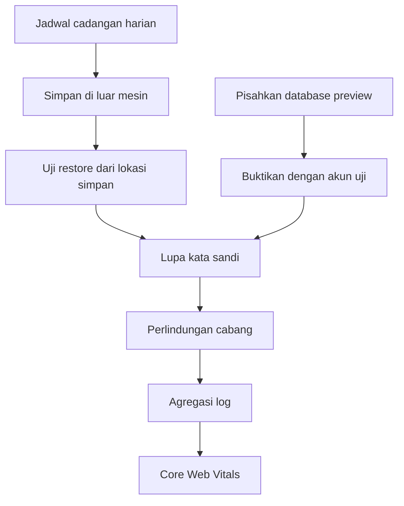

# 26. Rencana Siklus Berikutnya

Dokumen ini menjawab satu pertanyaan: setelah 0.18.0 tayang dan pemantauan berjalan, apa yang dikerjakan berikutnya.

Isinya tidak menambah janji baru. Setiap butir berasal dari daftar yang sudah ada di [`18`](18-Rencana-Produksi-dan-Pemakaian-Harian.md) bagian 18, [`25`](25-Pemeliharaan-dan-Monitoring.md) bagian 9, atau story yang belum selesai di [`10-Epik-dan-Story.md`](10-Epik-dan-Story.md).

---

## 1. Tema siklus

**Tahan dipakai sendiri.**

Sampai sekarang aplikasi sudah bisa dipakai, tapi belum aman ditinggal. Tiga hal yang membuatnya belum tahan: cadangan belum berjadwal, kata sandi tidak bisa dipulihkan, dan preview deployment belum dipastikan tidak menyentuh data produksi.

Ketiganya bukan fitur baru. Ketiganya adalah syarat supaya orang boleh menaruh data pernikahan sungguhan di sini.

---

## 2. Dasar penyusunan

| Sumber | Yang diambil |
|---|---|
| [`18`](18-Rencana-Produksi-dan-Pemakaian-Harian.md) bagian 18 | Celah yang belum selesai, termasuk cadangan, pemisahan database, dan aksesibilitas |
| [`25`](25-Pemeliharaan-dan-Monitoring.md) bagian 9 | Yang belum dipantau, termasuk agregasi log dan Core Web Vitals |
| [`10`](10-Epik-dan-Story.md) | Story yang belum dikerjakan, termasuk E2.3 verifikasi email dan E8.4 backup |
| [`19`](19-Rencana-Perbaikan-Audit.md) dan [`20`](20-Hasil-Audit-Menyeluruh.md) | Temuan yang sudah ditutup, untuk memastikan tidak kembali |

Yang tidak dipakai sebagai dasar: daftar keinginan, permintaan pihak ketiga, dan apa pun yang belum punya masalah nyata yang menyala. `docs/06` bagian 4 mengatur itu.

---

## 3. Prioritas

### 3.1 P0, menyentuh data

| # | Pekerjaan | Kenapa P0 | Syarat selesai |
|---|---|---|---|
| 1 | Jadwal cadangan harian | Satu-satunya perlindungan terhadap kehilangan catatan pembayaran | Dump berjalan otomatis tiap hari, tersimpan di luar mesin aplikasi, dan tiga dump berturut-turut bisa dibuka |
| 2 | Penyimpanan cadangan di luar penyedia database | Cadangan di mesin yang sama tidak menolong saat mesin itu hilang | Satu dump dipulihkan dari lokasi penyimpanan, bukan dari mesin asal |
| 3 | Pastikan database preview berbeda dari produksi | Preview dibuat untuk setiap push cabang. Kalau menunjuk database produksi, siapa pun yang membuka URL preview bisa menulis ke data sungguhan | `DATABASE_URL` di lingkungan preview menunjuk database lain, dibuktikan dengan satu akun uji yang tidak muncul di produksi |

Ketiganya bisa dikerjakan tanpa satu baris kode aplikasi. Yang dibutuhkan hanya pengaturan dan satu skrip yang sudah ada (`scripts/cadangan.mjs`).

### 3.2 P1, menyentuh kepercayaan

| # | Pekerjaan | Kenapa P1 | Syarat selesai |
|---|---|---|---|
| 4 | Lupa kata sandi | Sekarang pengguna yang lupa kata sandi tidak punya jalan pulih selain menghubungi pemilik. Akun Google tidak terkena, akun kata sandi terkena | Tautan atur ulang dikirim lewat WhatsApp, berlaku sekali, dan kedaluwarsa. Diuji dengan satu akun yang benar-benar lupa |
| 5 | Perlindungan cabang | CI sudah hijau, tapi belum diwajibkan. Satu merge tanpa CI tetap mungkin | `main` menolak merge saat CI merah |
| 6 | Agregasi log galat | Satu-satunya galat yang terlihat adalah yang dibaca manual di dashboard | Galat 5xx dari produksi terkumpul di satu tempat dan bisa dicari |
| 7 | Angka Core Web Vitals | Waktu jawab API sudah diukur, waktu render halaman belum | Satu pengukuran Lighthouse untuk Beranda di mobile, dicatat dengan tanggal |

### 3.3 P2, menyentuh kenyamanan

| # | Pekerjaan | Kenapa P2 | Syarat selesai |
|---|---|---|---|
| 8 | Verifikasi email | Butuh penyedia surel, dan belum ada laporan salah masuk | Hanya dikerjakan kalau nomor 4 selesai dan surel sudah ada |
| 9 | Uji aksesibilitas otomatis | Kontras diukur manual dan hasilnya baik, tapi belum ada yang mencegah kemunduran | Pemeriksaan kontras dan label berjalan di CI |
| 10 | Unggah bukti transfer | Butuh object storage, dan `docs/08` sudah mencatat kenapa ditunda | Dikerjakan hanya kalau ada permintaan nyata dari pengguna |

### 3.4 P3, kebersihan

| # | Pekerjaan | Syarat selesai |
|---|---|---|
| 11 | Tinjau `docs/18` bagian 18 | Setiap baris yang sudah selesai dicoret, dan setiap baris baru punya alasan |
| 12 | Putuskan naik `next` 16 | Lima pertanyaan `docs/06` dijawab, termasuk biaya migrasi dari 15.5 |
| 13 | Retro siklus 0.18.0 | Satu paragraf per pertanyaan di `docs/25` bagian 6 |

---

## 4. Yang sengaja tidak masuk siklus ini

| Tidak dikerjakan | Alasan |
|---|---|
| Gerbang pembayaran | Produk terpisah, dan belum ada pengguna yang memintanya. `docs/01` bagian 4 |
| Lokapasar vendor | Sama |
| Multi bahasa | `docs/01` menetapkan satu bahasa |
| Editor teks kaya | Ditolak di `docs/01` bagian 4 |
| Alat observability berbayar | `docs/06` menolak Sentry. Nomor 6 dikerjakan dengan alat yang sudah ada kalau memungkinkan |
| Kubernetes dan container | Dijawab di `docs/24` bagian 10 |

Kalau salah satu dari daftar ini dibutuhkan nanti, lima pertanyaan `docs/06` bagian 4 yang menentukan, bukan dokumen ini.

---

## 5. Ukuran keberhasilan

Angka di bawah dipakai sebagai pembanding, bukan target karangan. Kolom "pembanding" berisi angka yang benar-benar sudah diukur.

| Ukuran | Pembanding | Cara mengukur ulang |
|---|---|---|
| Waktu jawab `/api/siap` | p95 79ms sampai 99ms, 19 Oktober 2026 | `npm run kinerja` |
| Waktu jawab `/api/kesehatan` | p95 125ms sampai 135ms, 19 Oktober 2026 | sama |
| Test otomatis | 158 test Vitest, 17 test Playwright | `npm test`, `npm run test:e2e` |
| Cadangan | Satu uji restore berhasil, 16 tabel, 8 users, 9 plans, 21 payments | `npm run cadangan` lalu `--pulihkan` |
| Kontras | 0 gagal di terang dan gelap | Diukur ulang setelah perubahan tampilan |

Aturan yang dipegang: kalau sebuah pekerjaan selesai tapi tidak ada angka pembanding yang bisa diukur, pekerjaan itu belum selesai. Itu aturan `AGENTS.md` bagian 3 butir 5.

---

## 6. Urutan pengerjaan

Alasannya: nomor 1 sampai 3 melindungi data, dan tidak ada pekerjaan lain yang berguna kalau data bisa hilang. Nomor 4 baru masuk setelah itu, karena lupa kata sandi adalah satu-satunya cacat yang membuat pengguna kehilangan akses ke datanya sendiri.

---

## 7. Gerbang per pekerjaan

Tidak ada aturan baru. Setiap pekerjaan memakai gerbang yang sudah ada:

| Gerbang | Rujukan |
|---|---|
| Enam perintah pra-rilis | [`23`](23-Rilis-dan-Penyebaran.md) bagian 3.1 |
| Enam pemeriksaan pasca-deploy | [`23`](23-Rilis-dan-Penyebaran.md) bagian 3.4 |
| Daftar periksa kirim | `AGENTS.md` bagian 8 |
| Entri `CHANGELOG.md` | `AGENTS.md` bagian 7 |

Pekerjaan nomor 1 sampai 3 tidak menyentuh kode, jadi gerbangnya berbeda: bukti berupa keluaran perintah dan satu uji restore yang berhasil.

---

## 8. Yang perlu diputuskan pemilik produk

Dua hal ini bukan keputusan teknis, dan tidak bisa dijawab dokumen:

| Pertanyaan | Kenapa harus dijawab dulu |
|---|---|
| Berapa lama data boleh hilang kalau terjadi bencana | Menentukan seberapa sering cadangan dijalankan. Sekali sehari, sekali sejam, atau terus-menerus punya biaya berbeda |
| Apakah akun boleh dipulihkan lewat WhatsApp, bukan surel | Menentukan bentuk nomor 4. WhatsApp sudah jadi jalur utama aplikasi ini, tapi itu keputusan produk |

Selama dua pertanyaan itu belum dijawab, nomor 1 dan 4 hanya bisa dikerjakan sebagian.
